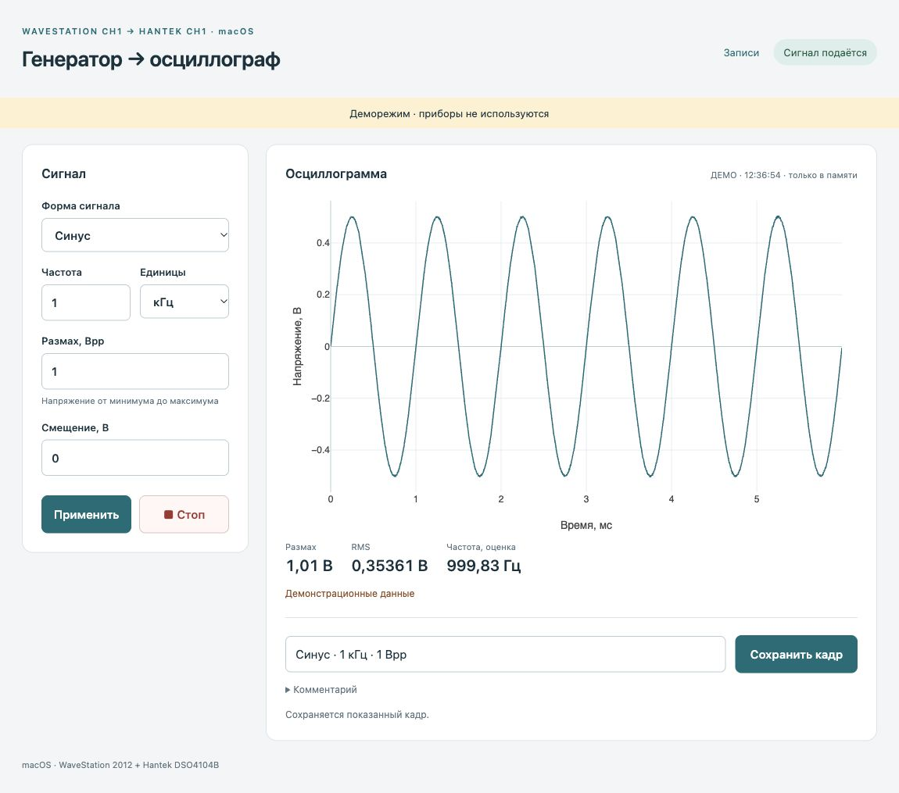

# WaveBench · macOS

Управление **LeCroy WaveStation 2012** и **Hantek DSO4104B** по USB: параметры → **Пуск** → осциллограмма → **Сохранить кадр**.

Сделано для Mac. Проверено на **MacBook Air M4, Python 3.12**. Другие ОС и модели приборов не проверены.



Пример интерфейса в деморежиме: синус 1 кГц, 1 Вpp. Данные синтетические.

## Подключение

```text
Mac → USB-хаб → USB-A/B → WaveStation 2012
             → USB-A/B → Hantek DSO4104B
WaveStation CH1 → BNC → Hantek CH1
```

На генераторе выберите **Utility → Interface → USB Setup → USBTMC**. Для этой версии: прямое соединение, вход осциллографа 1 МОм, щуп ×1. Системные драйверы производителей не нужны: USB работает через libusb.

## Запуск

Установите Python 3.12 (`brew install python@3.12`), затем:

```sh
git clone https://github.com/iuriigrishin/wavebench-macos.git
cd wavebench-macos
./setup.command
./start.command
```

Окно: [localhost:8765](http://127.0.0.1:8765). Без приборов: `./demo.command` ([порт 8766](http://127.0.0.1:8766)). После установки приложение работает без интернета.

**Пуск** применяет параметры, включает CH1 и обновляет график. **Стоп** выключает выход. До нажатия **Сохранить кадр** измерения остаются в памяти.

Записи: `data/runs/дата/время — название — сигнал/`. В каждой — читаемый HTML, CSV, графики, массивы и настройки. Кнопка **Записи** открывает архив. Данные и локальные настройки исключены из Git.

Приборы находятся автоматически. Если одинаковых приборов несколько, скопируйте `config.example.json` в `config.json` и задайте `generator_serial` / `scope_serial`.
